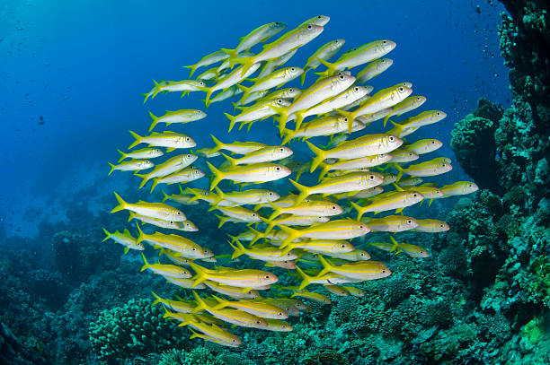

<p align="center">
  
</p>


<center>

# 🌊 Wa-Tor — Simulation proie-prédateur en Python objet

</center>

Wa-Tor est une simulation écologique inventée par A. K. Dewdney (1984). Une planète en forme de tore, entièrement recouverte d'eau, est peuplée de **poissons** (proies) et de **requins** (prédateurs). À chaque unité de temps (le **chronon**), chaque créature se déplace, se nourrit, se reproduit ou meurt, et les populations évoluent de façon cyclique.

Ce projet implémente cette simulation en **programmation orientée objet**.

---

## Table des matières
- [🌊 Wa-Tor — Simulation proie-prédateur en Python objet](#-wa-tor--simulation-proie-prédateur-en-python-objet)
  - [Table des matières](#table-des-matières)
  - [Aperçu](#aperçu)
  - [Les espèces](#les-espèces)
    - [Règles détaillées](#règles-détaillées)
  - [Fonctionnement de la simulation](#fonctionnement-de-la-simulation)
  - [Architecture du projet](#architecture-du-projet)
    - [Hiérarchie des classes](#hiérarchie-des-classes)
    - [Rôle des modules](#rôle-des-modules)
  - [Installation](#installation)
  - [Lancer la simulation](#lancer-la-simulation)
    - [Version console + graphique](#version-console--graphique)
    - [Version Pygame](#version-pygame)
  - [Configurations](#configurations)
  - [Utilisation](#utilisation)
  - [Personnaliser la simulation](#personnaliser-la-simulation)
    - [Ajouter une nouvelle espèce](#ajouter-une-nouvelle-espèce)
  - [Contributeurs](#contributeurs)
  - [Références](#références)

---

## Aperçu

| Élément | Description |
|---|---|
| Planète | Grille 2D **torique** : sortir par un bord fait réapparaître la créature du côté opposé |
| Temps | Découpé en **chronons** ; une créature agit une fois par chronon |
| Espèces | `Fish`, `Shark` (Bonus : `Flying_fish`, `Super_fish`) |
| Affichage | Console (ANSI), graphique matplotlib en direct, fenêtre Pygame |
| Paramétrage | Fichiers `env_config.py` (taille, peuplement initial, gestation, énergie…) |

---

## Les espèces

Toutes les espèces héritent de la classe `Fish`, qui fournit le cycle de vie, le déplacement et la reproduction.

| Espèce | Couleur (Pygame) | Déplacement | Particularités |
|---|---|---|---|
| **Fish** (poisson) | 🟩 Vert | 4 directions (haut, bas, gauche, droite) | Proie de base, gestation de 4 chronons |
| **Shark** (requin) | 🟥 Rouge | 4 directions | Mange les poissons adjacents en priorité, perd 1 énergie par chronon, meurt à 0, gestation de 8 chronons |
| **Bonus**
| **Flying_fish** (poisson volant) | 🟢 Vert foncé | 4 **diagonales** uniquement | Hérite de la reproduction de `Fish` |
| **Super_fish** (super poisson) | 🟧 Orange | **8 directions** (cardinales + diagonales) | Hérite de la reproduction de `Fish` |

---

### Règles détaillées

**Poisson (et variantes)**
1. Il observe ses cases voisines (selon son type de déplacement).
2. S'il y a au moins une case vide, il se déplace sur l'une d'elles, choisie au hasard.
3. Son compteur de gestation (`pregnancy`) augmente de 1.
4. Si `pregnancy >= gestation_period` **et** qu'il vient de se déplacer, un nouveau poisson du même type naît sur sa case d'origine et le compteur repart à 0.

**Requin**
1. Si son énergie est à 0, il meurt de faim.
2. Il observe ses 4 cases voisines : s'il y a des proies (tout `Fish` qui n'est pas un `Shark`), il en **mange une au hasard** et gagne `energy_regain` (plafonné à `max_energy`). Sinon, il se déplace sur une case vide au hasard.
3. Il se reproduit selon la même règle que les poissons (avec sa propre période de gestation).
4. Il perd 1 point d'énergie en fin de cycle.

---

## Fonctionnement de la simulation

À chaque chronon, la planète parcourt ses créatures et appelle leur méthode `life_cycle(matrice)`. Une créature mangée ou morte pendant le chronon n'agit pas (le code vérifie que la case contient toujours la même instance).

Deux modes de mise à jour existent, choisis via `version_update_planet` dans la configuration :

| Version | Méthode | Ordre de passage |
|---|---|---|
| `"V1"` | `Planet.update_planet()` | Ordre de la grille (FIFO) |
| `"V2"` | `Planet.update_planet_V2()` | **Ordre aléatoire**, ce qui évite les biais liés à la position |

---

## Architecture du projet

Les imports du code (`world.planet`, `graph.graph`, `config`) supposent l'arborescence suivante :

```
wa-tor/
├── main.py                 # Point d'entrée : console + graphique matplotlib
├── main_pygame.py          # Point d'entrée : fenêtre Pygame
├── config/
│   ├── env_config1.py      # Poissons + requins, mise à jour V1
│   ├── env_config2.py      # Poissons + requins, mise à jour V2
│   ├── env_config3.py      # Poissons volants + requins
│   ├── env_config4.py      # Super poissons + requins
│   ├── env_config5.py      # Poissons + super poissons + requins
│   ├── env_config6.py      # Toutes les espèces
│   └── graph_config.py     # Points affichés et pause du graphique
├── world/
│   ├── planet.py           # Grille, peuplement, mise à jour, affichage console
│   ├── fish.py             # Classe parente
│   ├── shark.py            # Prédateur
│   ├── flying_fish.py      # Déplacement en diagonale
│   └── super_fish.py       # Déplacement dans les 8 directions
├── graph/
│   └── graph.py            # Graphique d'évolution des populations
└── requirements.txt
```

### Hiérarchie des classes

```
Fish
├── Shark
├── Flying_fish
└── Super_fish
```


### Rôle des modules

- **`Planet`** : construit la matrice, la peuple aléatoirement selon des poids de probabilité (`populate`), liste les créatures (`get_all_creatures`), fait avancer le temps (`update_planet`, `update_planet_V2`) et affiche la grille en console (`show_planet`).
- **`Fish`** : attributs `x`, `y`, `pregnancy`, `gestation_period` ; méthodes `life_cycle`, `look_out`, `move`, `reproduce`.
- **`Graph`** : conserve un historique glissant (`deque`) des effectifs de chaque espèce et rafraîchit les courbes matplotlib à chaque chronon.

---

## Installation

**Prérequis** : Python 3.14 

```bash
# 1. Cloner le dépôt
git clone <url-du-depot>
cd wa-tor

# 2. (Recommandé) créer un environnement virtuel
python -m venv .venv
source .venv/bin/activate        # Windows : .venv\Scripts\activate

# 3. Installer les dépendances
pip install -r requirements.txt
```

Dépendances principales : `matplotlib` (graphique) et `pygame-ce` (fenêtre graphique).

---

## Lancer la simulation

### Version console + graphique

```bash
python main.py
```

- La grille s'affiche dans le terminal (blocs de couleur ANSI) et le graphique des populations s'ouvre dans une fenêtre matplotlib.
- La simulation s'arrête quand on **ferme la fenêtre du graphique**.
- Le script utilise `os.system('clear')`.

### Version Pygame

```bash
python main_pygame.py
```

- Chaque case est un carré de 20 px ; la simulation tourne à 5 images par seconde.
- La simulation s'arrête à la fermeture de la fenêtre.

---

## Configurations

Six configurations sont fournies. La grille fait 60 × 60 dans tous les cas.

| Config | Mise à jour | Espèces | Poids initiaux (Fish / Shark / Flying / Super / vide) | Gestation Super_fish |
|---|---|---|---|---|
| `env_config1` | V1 | Poissons + requins | 15 / 8 / 0 / 0 / 77 | 4 |
| `env_config2` | V2 | Poissons + requins | 15 / 8 / 0 / 0 / 77 | 4 |
| `env_config3` | V2 | Poissons volants + requins | 0 / 8 / 15 / 0 / 77 | 4 |
| `env_config4` | V2 | Super poissons + requins | 0 / 8 / 0 / 15 / 77 | 3 |
| `env_config5` | V2 | Poissons + super poissons + requins | 10 / 5 / 0 / 10 / 75 | 3 |
| `env_config6` | V2 | Toutes les espèces | 7 / 5 / 7 / 7 / 74 | 3 |

Pour changer de configuration, modifiez l'import dans le point d'entrée :

```python
# main.py ou main_pygame.py
from config import env_config4 as env_cfg
```

---

## Utilisation

La simulation évolue tour par tour (chronons). Pour obtenir un écosystème stable et éviter une extinction précoce de l'une des deux espèces, nous recommandons les critères optimaux suivants :

| Paramètre | Valeur recommandée |
| :--- | :--- |
| **Taille de la grille** | 60 x 60 |
| **Population initiale de requins** | 10% |
| **Population initiale de poissons** | 17% |
| **Temps de reproduction (requins)**| 8 chronons |
| **Temps de reproduction (poissons)**| 4 chronons |
| **Énergie initiale (requins)** | 6 |
| **Énergie maximale (requins)** | 12 |
| **Gain d'énergie par poisson mangé**| 6 |

---

## Personnaliser la simulation

Chaque fichier de configuration expose les paramètres suivants :

| Paramètre | Rôle |
|---|---|
| `x, y` | Dimensions de la grille (colonnes, lignes) |
| `types` | Contenus possibles d'une case : `"fish"`, `"shark"`, `"flying_fish"`, `"super_fish"`, `None` |
| `weight` | Poids de tirage pour chaque élément de `types` (même ordre), utilisés au peuplement initial |
| `version_update_planet` | `"V1"` (FIFO) ou `"V2"` (ordre aléatoire) |
| `fish_config` | `gestation_period` |
| `shark_config` | `gestation_period`, `energy`, `max_energy`, `energy_regain` |
| `flying_fish_config` | `gestation_period` |
| `super_fish_config` | `gestation_period` |

Le graphique se règle dans `graph_config.py` : `max_points` (nombre de chronons conservés, 400 par défaut) et `pause` (secondes entre deux rafraîchissements, 0,2 par défaut).

### Ajouter une nouvelle espèce

1. Créer `world/ma_espece.py` avec une classe qui hérite de `Fish`.
2. Redéfinir `__repr__` (affichage console) et, si besoin, `look_out` (déplacement) ou `life_cycle`.
3. Ajouter sa configuration dans les `env_configN.py`, son type dans `types` et son poids dans `weight`.
4. Gérer son cas dans `Planet.populate`, dans `Graph` (nouvelle courbe) et dans `main_pygame.py` (couleur).

---

## Contributeurs

Projet réalisé en groupe dans le cadre d'une formation Python orienté objet.
*   Benoit Michaux ([@ArkantHiris](https://github.com))
*   Loïc HURBLAIN ([@loic-hu](https://github.com))
*   Xavier Durieux ([@xav02165](https://github.com))

---

## Références

- A. K. Dewdney, « Computer Recreations: Sharks and fish wage an ecological war on the toroidal planet Wa-Tor », *Scientific American*, décembre 1984.

---

<p align="center">
  
</p>